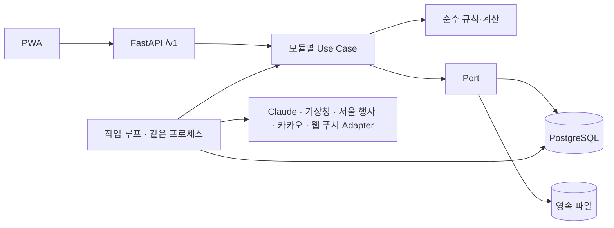

# 전체 아키텍처

## 실행 구조

FastAPI 프로세스 1개와 PostgreSQL을 쓴다(D05). 비동기 작업은 `background_job` 테이블에 저장하고, API 프로세스가 시작할 때 띄우는 작업 루프 1개가 꺼내 실행한다. 정해진 시각의 작업(19:50, 20:00, 07:20, 07:30)도 같은 루프가 등록한다. 업로드 원본은 영속 파일 저장소에 두고 DB에는 위치만 저장한다. 외부 서비스 호출은 adapter가 담당한다. Redis, 메시지 버스, 별도 worker 프로세스는 두지 않는다.

uvicorn은 프로세스 1개로 실행한다(현재 Dockerfile과 같다). 서버를 2대 이상으로 늘리거나 uvicorn worker 수를 올리려면 그때 작업 루프를 분리하고 작업 선점 잠금을 추가한다.



## 권장 코드 위치

아래는 권장 구조다. 실제 구현은 모듈을 폴더 대신 파일 하나(`app/modules/<이름>.py`)로 두었다(D36). 소유권과 의존 방향은 같다.

```text
app/
  main.py                         # 기존 엔트리, 라우터·작업 루프 연결
  bootstrap.py                    # 설정/포트 구현/유스케이스 조립
  shared/                         # ID, 단위, Clock, 오류, UoW
  api/                            # 예외 변환, dependency, router 등록
  modules/
    stores/                       # store, push token, 좌표
    catalog/                      # menu, ingredient, recipe, 후보/CORE
    sales/                        # sales_import, daily_sales
    receipts/                     # receipt_scan, receipt_line 확정
    suppliers/                    # supplier, 주문 요일, 전화번호
    forecasting/                  # forecast, weather, event, 과거 날씨 관측, 예측 모델
    inventory/                    # 입고·판매로 재고를 계산(읽기 전용)
    ordering/                     # 발주 계획, 발주서, 전송 기록, 재고 부족 안내
    views/                        # 여러 모듈 결과를 조합하는 화면 단위 유스케이스
  infrastructure/
    db/                           # ORM, SQL, UoW, migrations
    files/                        # FileStore adapter
    providers/                    # 외부 서비스 adapter
    jobs/                         # 작업 큐, 작업 루프, 스케줄 등록, handler
  policies/defaults.toml          # 정책 기본값(docs/spec/policy-defaults.toml을 옮긴 것)
tests/{unit,contract,integration,acceptance}/
```

## 모듈 소유권과 의존 방향

| 모듈 | 쓰는 테이블 | 읽는 다른 모듈 |
|---|---|---|
| stores | store | — |
| catalog | menu, ingredient, recipe_item | — |
| sales | sales_import, daily_sales | catalog(쓰기 포트로 메뉴 등록) |
| suppliers | supplier | — |
| receipts | receipt_scan, receipt_line | catalog·suppliers(쓰기 포트) |
| forecasting | forecast, weather, event, weather_observation, store.forecast_model | sales, catalog, stores |
| inventory | 없음 | receipts, sales, catalog |
| ordering | purchase_order, purchase_order_line | forecasting, inventory, receipts(단가), suppliers, catalog |
| views | 없음 | 위 전부 |

의존은 한 방향이다: `views → ordering → inventory·forecasting → receipts/sales/catalog/stores`. 아래 모듈이 위 모듈을 부르지 않는다. inventory는 forecasting을 읽지 않는다(재고는 입고와 판매만으로 계산한다, D03). `store.forecast_model` 칸은 forecasting만 쓴다.

여러 모듈의 결과를 한 응답으로 묶는 유스케이스는 `views`에 둔다. 다른 모듈에 두면 순환이 생긴다.

| operation | 소유 | 이유 |
|---|---|---|
| getHome | views | 예측·날씨·행사·발주 요약·재고 부족 안내를 조합 |
| adjustForecast | views | 준비량 저장(forecasting) 뒤 발주 요약(ordering)을 다시 계산 |
| listIngredients | views | 재료(catalog)·단가(receipts)·거래처(suppliers)를 조합 |

**발주 계획은 `ordering.PlanOrder` 한 곳에서만 만든다.** getHome, adjustForecast, getOrderPlan은 이 유스케이스를 호출한다. 재고·단가·거래처·행사 입력을 각자 다시 모으지 않는다. **재고 부족 목록은 `ordering.FindLowStock` 한 곳에서만 만든다.** getHome과 NIGHT 푸시 발송이 이 유스케이스를 호출한다.

## 계층 규칙

- API: path/query/body 검증, DTO 변환, 유스케이스 1회 호출, HTTP 변환. SQL·계산·외부 호출 없음.
- Application: 소속 검증, 트랜잭션 범위, 포트 호출 순서, 작업 등록, 응답 조합.
- Domain: 입력 스냅샷에 대한 결정적 계산. DB, 환경변수, 현재 시각, 네트워크 접근 없음.
- Adapter: SQL/파일/HTTP 형식을 명명된 타입으로 변환. 외부 응답 JSON을 업무 모듈로 넘기지 않는다.
- Composition root: adapter 선택과 의존 주입. 테스트는 Clock과 포트를 fake로 바꿀 수 있어야 한다.

## 일관성과 트랜잭션

- 쓰기 유스케이스는 store 행을 `FOR UPDATE`로 잠그고 시작해 한 트랜잭션에서 끝낸다. 같은 가게의 쓰기는 차례로 실행된다. 묶음 저장의 일부만 남기지 않는다.
- 작업 루프의 handler도 결과를 반영할 때 같은 방식으로 store 행을 잠근다. 외부 서비스 호출은 잠금 밖에서 한다.
- 조회 조합은 한 읽기 전용 트랜잭션(REPEATABLE READ)에서 순차적으로 읽는다. 한 세션을 동시에 여러 작업이 쓰지 않는다.
- 비동기 요청은 업무 상태와 `background_job` 행을 같은 트랜잭션에 저장한 뒤 202를 돌려준다.

사용자 저장과 작업 결과가 서로 덮어쓰지 않게 하는 규칙은 두 가지뿐이다.

1. 레시피 생성 중(`generation_status=GENERATING`)에는 setCoreIngredients와 saveRecipes를 422로 막는다.
2. 예측 작업은 `recommended`, `baseline`, `event_diff`, `summary_text`, `previous_recommended`만 쓴다. `adjusted`와 `produced`는 사용자 요청만 쓴다. `store.forecast_model`은 FIT_FORECAST_MODEL 작업만 쓴다.

## 데이터 변경 뒤의 후속 처리

계산 결과 중 예측은 forecast에 저장하고, 밤사이 비교와 푸시에 필요한 시점별 결과는 해당 예측 작업에 남긴다. 예측 모델은 `store.forecast_model`에 저장한다. 발주 계획, 재고, 재고 부족 목록은 조회할 때 계산하므로 무효화할 캐시가 없다.

| 변경 | 같은 트랜잭션에서 등록하는 작업 |
|---|---|
| 판매 반영 완료 | 새 메뉴가 있으면 GENERATE_RECIPES, FIT_FORECAST_MODEL |
| 예측 모델 계산 완료 | 오늘·내일 GENERATE_FORECAST |
| 가게 생성 | GEOCODE_STORE |
| 좌표 저장 완료 | 오늘·내일 REFRESH_CONTEXT |
| 날씨·행사 갱신 완료 | 해당 날짜 GENERATE_FORECAST |
| 준비량 PUT, 만든 양 PUT, CORE·레시피 저장, 영수증 확정, 주문 요일 저장, 발주 | 없음 (다음 조회에서 바로 반영) |
